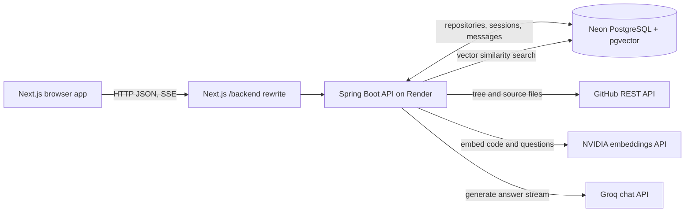
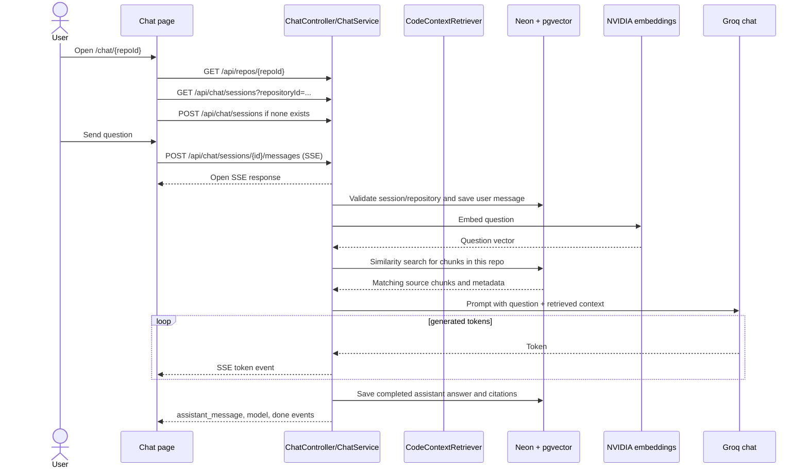
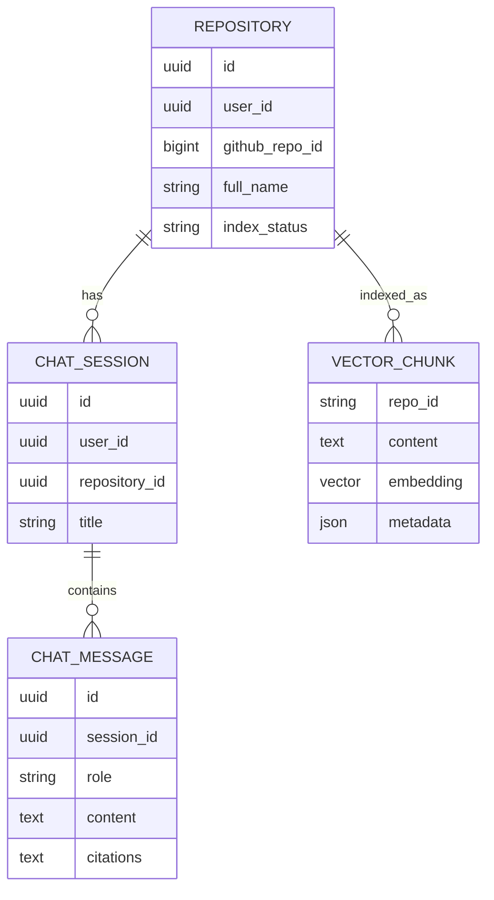

# DevPilot system design

This document describes the application as it exists in the repository, including important limitations. It is intended as a map for understanding and debugging the system, not as a claim that every production concern is already implemented.

## 1. What the product does

DevPilot accepts a public GitHub repository, downloads eligible source files through the GitHub API, splits the files into chunks, creates embeddings through NVIDIA's OpenAI-compatible API, and stores those vectors in PostgreSQL with pgvector. A user asks a question in chat; the backend embeds the question, retrieves similar chunks, sends those chunks and the question to Groq chat, and streams the answer and citations back to the browser.

## 2. System at a glance



### Main pieces

| Piece | Responsibility | Code/config |
|---|---|---|
| Browser app | Dashboard, repository status, chat UI, SSE parsing | `client/app`, `client/components`, `client/hooks`, `client/lib` |
| Same-origin proxy | Routes browser `/backend/...` calls to backend origin | `client/next.config.ts` |
| REST API | Repository, indexing status, chat session and message endpoints | `backend/.../controllers` |
| Services | Repository lookup, GitHub reads, indexing, retrieval, prompting, streaming | `backend/.../services` |
| PostgreSQL | Stores relational app data and pgvector chunk embeddings | `backend/.../entity`, `backend/.../repository`, application config |
| Model providers | NVIDIA embeddings, Groq chat | `backend/src/main/resources/application.properties` |

## 3. Repository indexing flow

```mermaid
sequenceDiagram
  actor User
  participant UI as Next.js UI
  participant API as Spring API
  participant GH as GitHub API
  participant Chunk as Filter/chunker
  participant NVIDIA as NVIDIA embeddings
  participant DB as Neon + pgvector

  User->>UI: Submit public GitHub URL
  UI->>API: POST /api/repos/analyze
  API->>GH: Resolve repo metadata
  API->>DB: Save/update repository
  API-->>UI: 202 Accepted + repository status
  UI->>API: POST /api/repos/{id}/index (if needed)
  API-->>UI: 202 Accepted; background job starts
  API->>DB: Set INDEXING, clear old vectors
  API->>GH: Read git tree and eligible file contents
  API->>Chunk: Filter files and split text into documents
  loop document batches
    API->>NVIDIA: Create embeddings
    NVIDIA-->>API: Vectors
    API->>DB: Store vector + text + metadata
  end
  API->>DB: Set READY or FAILED and progress
  UI->>API: Poll /api/repos/{id}/status while indexing
```

The file filter skips common generated/dependency folders and limits file size. Each chunk carries metadata such as repository ID, file path, language, and chunk index. The same repository ID is used later to limit retrieval to the selected repository.

## 4. Chat request flow



The browser uses React Query for repository/session/message fetches. `stream-chat.ts` parses SSE events. `ChatStreamHandler` emits lifecycle events and delegates provider/retrieval work to the services under `services/ai`.

## 5. Chat page startup: what loads, and in what order

When `/chat/{repoId}` is opened, the page itself is a small client wrapper. `ChatView` first requests repository details. If that request fails, it shows “Repository unavailable”; it never gets to the chat UI. After it has repository data, it requests indexing status when needed. It loads chat sessions only when the repository is `READY`, and creates a session if none exists. Only then is the composer enabled.

That means a blank/loading/error chat page can originate before any chat model call. Check in this order:

1. Browser Network panel: inspect `GET /backend/api/repos/{repoId}` and its status/body.
2. Next.js deployment: confirm its `/backend` rewrite points at the current backend origin.
3. Backend health/logs: confirm Spring finished starting and did not restart.
4. Backend startup dependencies: PostgreSQL, pgvector, Groq credentials, and NVIDIA embedding configuration.
5. Once the repository loads, check status endpoint and whether indexing reached `READY`.
6. Only after a session exists, diagnose the SSE request and model calls.

In the latest checked source, `client/next.config.ts` rewrites `/backend/*` to `https://devpilot-backend-iso1.onrender.com` unless `NEXT_PUBLIC_API_BASE_URL` overrides it. `ChatView` depends on that backend for its first repository request.

## 6. Runtime configuration

The backend currently expects these Render variables/properties:

| Environment variable | Used for |
|---|---|
| `SPRING_DATASOURCE_URL` | JDBC URL for Neon PostgreSQL |
| `SPRING_DATASOURCE_USERNAME` | Neon database user |
| `SPRING_DATASOURCE_PASSWORD` | Neon database password |
| `GROQ_API_KEY` | Groq chat API credential |
| `GROQ_CHAT_MODELS` | Optional ordered/fallback chat model list |
| `NVIDIA_API_KEY` | NVIDIA embeddings API credential |
| `GITHUB_TOKEN` | Optional GitHub API rate limit headroom |
| `APP_CORS_ALLOWED_ORIGINS` | Allowed browser origins (comma-separated) |
| `NEXT_PUBLIC_API_BASE_URL` | Optional frontend rewrite destination (frontend deploy) |

The latest source config uses `https://integrate.api.nvidia.com/v1` and model `nvidia/nv-embedqa-e5-v5`; pgvector is configured for 1024 dimensions. The exact Spring AI embedding auto-configuration behavior must be confirmed by a successful backend startup/package and a real embedding call; configuration spelling alone does not prove the model bean is active.

Locally, `docker-compose.yml` starts only PostgreSQL with pgvector on host port 5433. Start the Spring app separately, then start the Next.js app separately.

## 7. Data model



The vector table is managed by Spring AI's pgvector store rather than the JPA entities. The diagram shows the logical relation; the physical vector schema is library-managed.

## 8. Failure map

| Symptom | Most likely layer | First check |
|---|---|---|
| Chat route says repository unavailable | Frontend proxy/backend/API/database | `GET /api/repos/{id}` and Render startup logs |
| Repository exists but chat is locked | Indexing | `/api/repos/{id}/status`, then indexing logs |
| Startup says no embedding credential | NVIDIA Spring AI model configuration | Active `EmbeddingModel` bean and `NVIDIA_API_KEY` property binding |
| Startup says no `EmbeddingModel` bean | Spring AI auto-configuration | Embedding model selection property and dependency auto-config report |
| Chat SSE errors before tokens | Retrieval/embedding or chat provider | SSE `error` event and backend stage logs |
| Chat returns answer without code grounding | Retrieval/filter/vector metadata | Similarity search output and repo-ID filter |
| 404/502 via browser | Frontend rewrite or backend not healthy | Browser Network URL/status and `/api/health` |

## 9. Important current limitations

- **The application is effectively a shared anonymous workspace.** `SecurityConfig` permits every request, and controllers use one fixed `AnonymousWorkspace.ID`. The README mentions authentication, but the current API does not authenticate users or isolate their data. Do not treat this as multi-user secure access.
- **A successful frontend build does not prove backend startup.** The UI and backend deploy separately. The browser can load static page assets while every API call fails because the Render backend is down.
- **A successful backend package does not prove provider access.** API keys, provider URLs, model names, quota, networking, and database extension state are runtime concerns.
- **Indexing is background work.** The HTTP 202 means accepted, not completed. The UI should poll status and only permit chat after `READY`.

## 10. Mental model

Think of the system as two stages:

1. **Prepare the library:** GitHub files → filtered/chunked text → NVIDIA vectors → pgvector.
2. **Answer a question:** question → NVIDIA vector → nearest stored chunks → Groq answer → stream to browser.

The vector database does not generate text. NVIDIA does not write the chat answer. Groq does not search the repository by itself. The backend coordinates those steps and carries the source citations back to the browser.
